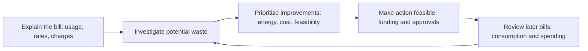
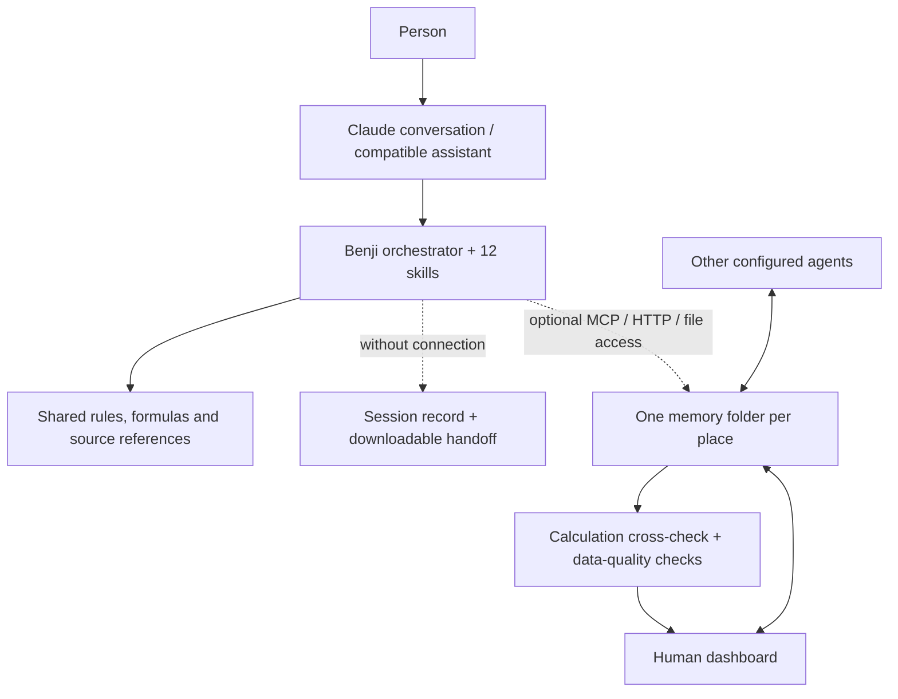

<div align="center">


# Benji
### Less energy waste. A clearer path to savings.

**An AI assistant that explains energy bills and helps homes and small businesses improve energy efficiency.**

Hackachusetts 2026 · **TRACK 3 — CLIMATE TECH**

Challenge: **Cleaner, more affordable buildings**

[Try in Claude](#1-easiest-one-skill-in-claude) · [Try in ChatGPT](#2-chatgpt) · [How it works](#one-workflow-from-bill-to-follow-through) · [Measuring progress](#what-success-looks-like) · [For judges](docs/JUDGING_GUIDE.md)

</div>

> “Why is our energy bill so high, what should we change first, and how will we know it worked?”

**Benji turns energy bills and building information into a practical energy-efficiency plan.** Bring electricity and heating bills, building plans and room layouts, thermal images, equipment lists and operating schedules. The assistant uses the available evidence to investigate heat loss, uneven temperatures, heating and cooling schedules, equipment consumption and lighting efficiency. It explains what drives spending, compares feasible improvements by energy use and cost, and helps users find support such as Mass Save. After an action, it guides a comparison with later bills to check what changed.

Plans and thermal images provide context for AI-assisted investigation when the host supports those files. Quantitative heat-loss, warm-up and lighting estimates require sourced dimensions, system performance, temperatures or fixture data; an image alone does not establish energy losses or equipment capacity.

**The deliverable: a prioritized plan showing potential energy savings, costs, funding options and the next check.** Estimates in kWh or therms and dollars include their inputs and assumptions. Missing evidence becomes a specific question or measurement to collect.

Built for Massachusetts homes and small businesses, Benji combines **12 specialist skills and one orchestrator** for use in **Claude, ChatGPT or connected agents**, through the setup paths below. An optional dashboard keeps bills, questions and actions together. Start with a bill and a conversation; no sensors or dedicated hardware are required.

## The problem: a high bill does not tell you what to do

Residents and small businesses face three linked decisions: **why spending increased, which efficiency improvement is worth doing, and how to afford it.** A bill shows charges and total consumption; finding a useful action also requires equipment details, operating patterns and building context.

Higher rates, colder weather or longer opening hours can explain an increase. Potential waste needs investigation. Even a promising improvement can stall because of upfront cash, landlord approval or uncertainty about program requirements.

**Benji connects bill analysis to an affordable action and a follow-up check.** The objective is lower avoidable energy use and spending while maintaining comfort and essential building services. Program guidance supports that same objective by helping the user take the next verified step toward funding an improvement.

### Why this matters

| Evidence | Why it shapes Benji |
|---|---|
| **13.7% vs 3.2%**: median share of income spent on household energy by low-income households versus all households in the **Boston metro area**. AHS 2021 data, published in 2024. | Start with affordability and low-cost steps. Energy burden is not an estimate of how much energy is wasted. [ACEEE](https://www.aceee.org/sites/default/files/pdfs/data_update_-_city_energy_burdens_0.pdf) |
| A Massachusetts study of **31 small-multifamily nonparticipants** found that nearly all knew of Mass Save, but most had limited understanding of what it could do for their building. | Help with the route to participation, documents and responsibilities, not just a list of rebates. Small qualitative sample; not a statewide rate. [Guidehouse, 2022](https://ma-eeac.org/wp-content/uploads/MA21R36-B-MFB-Small-MF-Barriers_Report_FINAL_11MAR2022.pdf) |
| **5% of Boston's buildings account for nearly 40% of city carbon emissions**, according to the city. | Existing-building decisions matter for climate as well as bills. This is Boston-specific and not a claim about Benji's impact. [City of Boston](https://www.boston.gov/departments/environment/berdo) |

Mass Save and professional assessors already provide valuable assistance. Benji helps users prepare for and follow through with those services. It does not administer programs or replace an energy assessment. [Full research, dates and limitations](docs/EVIDENCE.md)

## One workflow, from bill to follow-through



| Step | What Benji helps with | What the user gets |
|---|---|---|
| **Understand** | Read back bill values for confirmation; record equipment, budget and who decides | A clear starting point, with unknowns visible |
| **Investigate** | Separate consumption from rates and fixed charges; look for unusual patterns; use suitable BERDO peers when available | Evidence-backed questions about potential waste |
| **Choose** | Consider operating schedules, lighting, envelope improvements and heating/cooling options | An ordered shortlist with assumptions and trade-offs |
| **Enable** | Check residential/commercial program routes, required evidence, cash timing and landlord consent | A funding checklist and a concrete next action |
| **Follow through** | Record the chosen action and completion date; compare later bills and operating conditions | An observed change in consumption and spending, kept separate from the original estimate |

### Example: a leased cafe with a $1,500 budget

The owner brings electricity and gas bills. Benji checks whether the increase comes from consumption or price, asks about operating changes and proposes an after-closing check of nonessential loads, such as an espresso machine left on standby. Any schedule change must fit the equipment’s operating requirements; essential refrigeration stays running. Monthly bills alone cannot identify which appliance caused the increase.

For lighting or HVAC work, Benji identifies the need for a quote and landlord approval. It helps check the business's assessment/program route and prepares the relevant questions. A rebate paid later is kept separate from cash required today. The owner leaves with one manageable action and a record to revisit when new information arrives.

This is the scenario in the optional **clearly labelled synthetic demo**, not a customer case study or measured saving.

## What success looks like

**The primary outcome is lower energy use for comparable building operation, with the cost effect shown separately.** Benji's workflow keeps the estimate, the completed action and the later bill comparison distinguishable.

| Measure | How progress is checked |
|---|---|
| **Energy use** | Electricity in kWh/day and gas in therms/day, using the same meter and comparable billing periods; record weather, occupancy and operating-hour changes |
| **Energy spending** | Actual bill dollars and estimated cost effects; separate changes in consumption from rates, fixed charges, demand charges and credits |
| **Feasibility** | Cash required now, confirmed support and estimated simple payback when inputs are sufficient and savings are positive |
| **Follow-through** | A dated completed action or verified assessment request, followed by review of later bills |

An observed before/after change is not proof that the action caused it. Weather and operating conditions must be considered; savings attributable to Benji have **not yet been demonstrated in the field**. The MVP provides the decision workflow and record for that evaluation. [Measurement plan](docs/IMPACT.md)

## Why the skills and workflow matter

The skills make the same energy-efficiency process reusable: **confirm the bill, explain the change, evaluate an action and check the result**. They bring energy-specific references, a portable place record and optional calculation checks into the assistant the user already works with. Funding and program checks help turn a recommended improvement into a feasible one.

- **In Claude or ChatGPT:** the installed skill/plugin guides the conversation and can produce a handoff record. The user can start without a local server.
- **With other agents:** connected agents can read the same profile, bills and plan, continue assigned work and log changes. They must be connected to the same memory location.
- **In the dashboard:** the human sees the next step, confirms bills, answers questions, assigns tasks and inspects what was saved.

This makes Benji's reasoning and assumptions inspectable and lets another connected agent continue the same plan. Its added value over a general assistant remains a hypothesis to test. Assigning a dashboard task does not launch an autonomous agent.

### The 13 skills

| Group | Skill | Purpose |
|---|---|---|
| Coordinate | [Orchestrator](skills/benji-orchestrator/SKILL.md) | Choose the relevant workflow and keep the next step manageable |
| Understand | [Profile](skills/benji-profile/SKILL.md) | Establish place, role, equipment, budget and authority |
| Understand | [Bills Import](skills/benji-bills-import/SKILL.md) | Read back extracted data and request confirmation |
| Understand | [Bill Explainer](skills/benji-bill-explainer/SKILL.md) | Explain consumption, rates, charges and period changes |
| Investigate | [Usage Patterns](skills/benji-usage-patterns/SKILL.md) | Find unusual use and plan checks for suspected waste |
| Investigate | [Benchmark](skills/benji-benchmark/SKILL.md) | Compare suitable BERDO peers or explain why comparison is unavailable |
| Investigate | [Comfort](skills/benji-comfort/SKILL.md) | Investigate hot/cold rooms, heat loss and heating/cooling needs |
| Decide | [Upgrade Options](skills/benji-upgrade-options/SKILL.md) | Compare operating changes and modernization options |
| Enable | [Programs](skills/benji-programs/SKILL.md) | Find support routes, check conditions and prepare application information |
| Enable | [Funding](skills/benji-funding/SKILL.md) | Separate cash now, rebates later, financing and funding gaps |
| Act | [Action Plan](skills/benji-action-plan/SKILL.md) | Prioritize tasks and prepare landlord/contractor drafts |
| Check | [Follow-up](skills/benji-follow-up/SKILL.md) | Review progress and later bills when invoked |
| Share | [Report](skills/benji-report/SKILL.md) | Produce a short decision record for the relevant person |

Skills are instructions for the host AI. PDF/photo understanding and browsing depend on that host. The separate Python importer supports CSV, text PDFs and manual entry, not general photo OCR.

## Try Benji

### 1. Easiest: one skill in Claude

1. **[Download benji.zip](https://github.com/Fredess74/benji/raw/refs/heads/main/downloads/benji.zip)**. This contains the orchestrator, all 12 workflows and references; no bills, secrets or running server.
2. In Claude, open **Customize → Skills → + → Create skill → Upload a skill**, upload the ZIP and enable it. Code execution/file creation must be enabled; organization controls may also apply. [Official instructions](https://support.claude.com/en/articles/12512180-use-skills-in-claude)
3. Start a conversation:

   > Use Benji. I run a small cafe in Massachusetts and rent the space. My electricity bill increased. Help me understand the bill, investigate avoidable use, and check what assistance may apply. Read back any numbers before using them.

Use the same approach for a home, rental or apartment building. No local Python installation is needed for this skills-only route. Without connected memory tools, keep the record in the session and save the handoff for next time. Local dashboard synchronization is a separate setup. The archive is structurally checked; actual upload/invocation in every Claude account has not been tested.

### 2. ChatGPT

Where **Plugin Creator** is available in your account/workspace:

1. **[Download the ChatGPT package](https://github.com/Fredess74/benji/raw/refs/heads/main/downloads/benji-chatgpt-skills-0.2.1.zip)** — it includes all 13 skills, references and the Benji icon.
2. Start a ChatGPT conversation, select **@Plugin Creator**, attach the package and ask: **“Create a private Benji skills plugin from this package. Preserve the skills, references and host-capability rules. Do not add server connections.”** Review the result and complete the installation if prompted.
3. Start a new conversation, select **@Benji**, and provide your bills or building materials: **“Explain my energy spending, identify what to investigate, and prioritize efficiency improvements. Confirm extracted numbers with me first.”**

This follows OpenAI's [Plugin Creator workflow](https://learn.chatgpt.com/docs/build-plugins). Availability depends on account/workspace permissions. The archive is structurally checked; installation and behavior must be tested in the target ChatGPT account. Benji is **not currently a public-directory listing**.

No local Python/server is needed for this skills-only route. Records remain in the conversation or exported handoff unless separately connected. For optional shared-memory setup, including Custom GPT Actions where available, see the [connection guide](integrations/README.md).

### 3. Optional: shared memory and dashboard

Python **3.11+** is required for the server. Clone this repository and install its dependencies:

```bash
git clone https://github.com/Fredess74/benji.git
cd benji
python -m pip install -r requirements.txt
```

Set the same memory location for the server and agent **before** loading the demo or starting either.

PowerShell:

```powershell
$env:BENJI_MEMORY = "$HOME/benji-memory"
python scripts/load_demo.py
python -m uvicorn benji.api:app --host 127.0.0.1 --port 8000
```

macOS/Linux:

```bash
export BENJI_MEMORY="$HOME/benji-memory"
python scripts/load_demo.py
python -m uvicorn benji.api:app --host 127.0.0.1 --port 8000
```

Open **http://127.0.0.1:8000/app**. The demo command is optional; omit it to start with empty memory. It refuses to replace an existing demo unless `--reset` is requested.

| Dashboard view | User control |
|---|---|
| **Home** | Next step, bill totals and estimates, confirmations, questions, task owners and status |
| **Agents** | Recorded activity and assignments by channel, plus connection guidance |
| **Memory** | Inspect profile, bills, findings, plan, questions and log |
| **Activity** | Review recorded changes |

The interface refreshes saved data every 10 seconds. This is **not live energy telemetry**. Channel labels describe recorded activity; they do not authenticate a connected agent.

### 4. Claude Code or another agent

After installing Python dependencies in the environment Claude Code uses:

```text
/plugin marketplace add Fredess74/benji
/plugin install benji@benji
```

The Claude Code package declares the 13 skills and a local MCP server. Its memory defaults to `~/benji-memory`. Use that same path for the dashboard. The server has automated MCP checks; actual Claude Code installation remains to be verified in the client.

For Kiro, OpenClaw or another file-capable agent, load `skills/` using the host's supported mechanism and grant access to the intended memory folder. Schedules need separate host configuration. OpenClaw is an integration path, not a verified always-on deployment. [All connection modes](integrations/README.md)

## Architecture: one record, several ways to help



Memory uses readable Markdown and CSV. The optional server provides nine MCP tools, HTTP routes and deterministic calculations. The dashboard reads file memory; the detailed calculator API also has a separate SQLite store. Only supported profile/bill fields are bridged into the memory cross-check. [Architecture and boundaries](docs/ARCHITECTURE.md)

## Sustainability and climate impact: Cleaner, more affordable buildings

| Challenge direction | Benji's contribution |
|---|---|
| **Energy waste** | Investigate consumption changes and nonessential loads; distinguish evidence from suspicion |
| **Retrofit prioritization** | Start with feasible operating improvements, then compare upgrades against budget, condition and authority |
| **Building performance** | Explain bills and suitable peer comparisons; investigate comfort and heating/cooling scenarios |
| **Tenant and owner incentives** | Identify who pays, benefits and approves; prepare an actionable handoff |
| **Access to energy savings** | Make program routes, requirements, cash timing and next steps understandable |

The sustainability pathway is practical: **reduce avoidable demand, make useful improvements feasible, and check what changed**. Heat-pump comparisons keep operating cost and emissions separate; electrification can lower estimated emissions while increasing bills. Benji can prepare questions for clean-energy assessments, but does not model solar output, dispatch batteries or control equipment.

For programs, the intended improvement is better-prepared applicants and fewer wrong-route or incomplete next steps. This is a **testable objective**, not demonstrated program effectiveness. We would measure verified assessment requests, completed applications, completed upgrades and later consumption with weather/occupancy context. **No field savings or avoided emissions have been demonstrated yet.** [Impact and measurement plan](docs/IMPACT.md)

## Built with Kiro; checked against failure cases

Kiro requirements, design, steering and a test-on-save hook are preserved in `.kiro/`. The project combines agent-assisted development with deterministic calculations, property-based checks and regression tests for problems found during review. [Implementation story](docs/KIRO.md)

```bash
python -m pytest -q tests
python scripts/package_session_skill.py
```

The [verification record](docs/VERIFICATION.md) lists the current test result, reproduced defects, fixes and remaining limits. Passing tests cover specific behaviors; they are not a guarantee that no bugs remain or proof of external-client integration.

<details>
<summary><strong>Current limits and trust boundaries</strong></summary>

- Program catalog records are **unverified leads**. Check current official rules; the operator confirms eligibility and amounts. Benji is independent of Mass Save and its sponsors.
- BERDO covers larger Boston buildings, so many small shops and homes have too few comparable peers. A peer gap is not recoverable savings.
- Bill calculations currently support electricity and natural gas. A partial year scaled to 365 days is an estimate. Where only total and fixed charges are supplied, the legacy simple-bill input assumes the remainder is usage-based; supply the actual breakdown for demand charges, credits and taxes.
- Room calculations are simplified single-zone scenarios, not an HVAC design. Floor area alone cannot determine heating time. Electrical drawings are reference material, not a capacity or safety certification.
- Free-text quotes and approved rebates are not automatically imported into the memory cross-check; detailed calculator inputs are separate.
- API changes to bills/profile and question answers mark saved advice stale. Agents editing files directly must follow the same rule. Concurrent writers still need coordination; there is no conflict-resolution layer.
- Loading a skill does not create persistent memory, deliver reminders, submit applications or start device control. Host capabilities and any account costs remain separate.
- Run the server on localhost. `BENJI_API_KEY`, when configured, protects all data route families; it is a shared secret, not user accounts or a production multi-tenant security model.

</details>

## For the judges

| Criterion | What to inspect |
|---|---|
| **Potential Value** | A concrete bill-to-action problem, no-hardware entry, tenant-aware plans and program navigation. [Evidence](docs/EVIDENCE.md) · [Impact](docs/IMPACT.md) |
| **Implementation** | Kiro artifacts, reusable skills, shared memory, MCP/HTTP and tested calculations. [Kiro](docs/KIRO.md) · [Verification](docs/VERIFICATION.md) |
| **Quality and Design** | A next-step-first interface, confirmation gates, transparent estimates and portable records. [Judge's guide](docs/JUDGING_GUIDE.md) · [Demo](docs/DEMO_SCRIPT.md) |

```text
downloads/benji.zip      One-upload skill for a regular Claude session
downloads/benji-chatgpt-skills-0.2.1.zip  Skills-only package for ChatGPT setup
skills/                 Orchestrator, 12 workflows, rules and references
.claude-plugin/         Claude Code plugin and marketplace
benji/                  Memory, server, calculator and thermal model
dashboard/index.html    Interface with no frontend build step
data/processed/         De-identified BERDO peer extract
integrations/           Host-specific setup and packaging
.kiro/                  Specifications, steering and hook
tests/                  Automated checks and regression cases
docs/                   Research, architecture, impact and judging guide
```

Runtime bills and memory are excluded from Git. The repository is public but currently has **no project license**; public access is not an open-source license grant. [Third-party notices](THIRD_PARTY_NOTICES.md)
