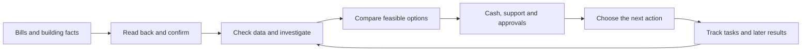
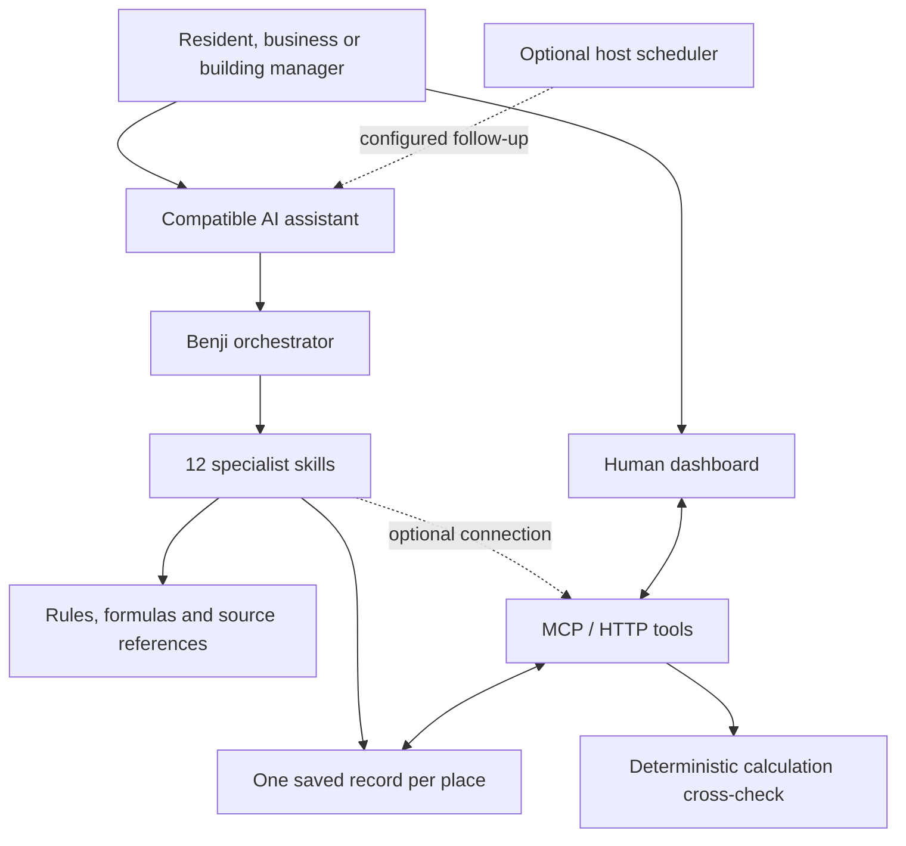

<div align="center">


# Benji
### Building energy decisions, made actionable.

**Energy-management skills for the AI assistant you already use — with shared memory and a dashboard that keeps people in control.**

**Hackachusetts 2026 · TRACK 3 — CLIMATE TECH**
**Challenge: Cleaner, more affordable buildings**

[The problem](#the-problem) · [How it works](#from-a-bill-to-an-action) · [Install](#try-benji) · [For judges](docs/JUDGING_GUIDE.md) · [Evidence](docs/EVIDENCE.md)

</div>

> “I run a coffee shop in Cambridge. We rent the space, our energy bills keep rising, and we have $1,500 available. What should we do first?”

Benji helps answer **what is happening, what can change, what needs to be paid now, and who must approve it**. The product is a set of **12 specialist skills and one orchestrator**. They guide a compatible assistant through bills, building conditions, improvement options and Massachusetts support. Optional tools connect the conversation to a persistent record and calculation cross-checks. The dashboard lets a person review and manage that work.

## The problem

An older building can need improvements while its occupants cannot afford a large initial payment. A renter may pay the bill but lack permission to change equipment. A small-business owner may know that assistance exists without knowing which conditions apply. A bill alone does not tell any of them what to do next.

### Why this matters

| Evidence | Product implication |
|---|---|
| **13.7% vs 3.2%**: median energy burden for low-income households versus all households in the **Boston metro area**. AHS 2021 data, published in 2024. | Affordability and comfort belong in the decision, alongside energy efficiency. [ACEEE](https://www.aceee.org/sites/default/files/pdfs/data_update_-_city_energy_burdens_0.pdf) |
| **92%** of Massachusetts electric commercial and industrial accounts were microbusiness accounts in **2022**. | Many small customers lack staff time and specialist expertise. Accounts are not businesses; the category includes some non-building loads. [DNV](https://ma-eeac.org/wp-content/uploads/MA24X30-CINPS-CI-Nonparticipant-Study-FINAL_1.17.2025.pdf) |
| **63% of 341 surveyed HEAT Loan participants** described the loan as essential to their project. | Cash needed now must be separated from eventual rebates and net cost. This is self-reported importance, not causal proof of additional projects. [2026 evaluation](https://ma-eeac.org/wp-content/uploads/MA25R08-B-HEAT_HEAT-Loan-Phase-1-Final-Report_2026-4-29.pdf) |
| Boston reports **5% of its buildings account for nearly 40% of city carbon emissions**. | Existing-building decisions matter for decarbonization. This is a Boston statistic, not a Massachusetts-wide estimate or a Benji result. [City of Boston](https://www.boston.gov/departments/environment/berdo) |

Awareness is not the same as access. In a Massachusetts study, only **5 of 31** interviewed small-multifamily nonparticipants had never heard of Mass Save, yet understanding of what applied to their buildings was limited. This small qualitative sample identifies a barrier; it is not a population-wide prevalence estimate. [Study](https://ma-eeac.org/wp-content/uploads/MA21R36-B-MFB-Small-MF-Barriers_Report_FINAL_11MAR2022.pdf)

Mass Save, city programs, ENERGY STAR tools and professional assessors already help. Benji aims to connect the user's evidence, constraints and next steps across those services. Its additional value over existing assistance remains to be tested. [Research and limitations](docs/EVIDENCE.md)

## From a bill to an action



For the cafe, Benji first establishes the lease, equipment and billing coverage. It may suggest checking what runs after closing, while distinguishing essential refrigeration from avoidable loads. It can prepare a landlord request before building work and separate a contractor quote from confirmed support.

If too few BERDO peers match, Benji declines to rank the cafe. If heating efficiency or heat-pump performance is unknown, it asks instead of manufacturing a payback. If a scenario reduces estimated emissions but raises operating cost, it shows both. **The useful output is a feasible next action with evidence and responsibility attached.**

## Skills, memory, tools and a human dashboard



- **Skills** specify what to ask, inspect, calculate and record. The host supplies the AI model.
- **Memory** stores profile, bills, findings, plan, questions and activity in inspectable Markdown/CSV files.
- **Tools** provide memory operations, supported financial cross-checks and room heating/cooling calculations.
- **Dashboard** lets people confirm values, answer questions, assign work and inspect the record.
- **Scheduled follow-up** requires a configured host. Loading Benji does not start an always-on monitor.

### The skill system

| Skill | Concrete job and output |
|---|---|
| [`benji-orchestrator`](skills/benji-orchestrator/SKILL.md) | Routes to at most two skills per turn; enforces confirmation, cash and authority gates |
| [`benji-profile`](skills/benji-profile/SKILL.md) | Records place type, role, utilities, equipment, budget and approval responsibilities |
| [`benji-bills-import`](skills/benji-bills-import/SKILL.md) | Produces a read-back table; extracted figures stay pending until confirmed |
| [`benji-bill-explainer`](skills/benji-bill-explainer/SKILL.md) | Separates consumption, prices, fixed charges and billing-period effects |
| [`benji-usage-patterns`](skills/benji-usage-patterns/SKILL.md) | Investigates unusual and after-hours use; monthly bills cannot identify an individual overnight load |
| [`benji-benchmark`](skills/benji-benchmark/SKILL.md) | Uses compatible BERDO peers or reports insufficient data; a peer gap is not savings |
| [`benji-comfort`](skills/benji-comfort/SKILL.md) | Investigates cold/hot rooms and warm-up; area alone cannot establish heating time |
| [`benji-upgrade-options`](skills/benji-upgrade-options/SKILL.md) | Compares operational/equipment choices with cost, carbon and approval trade-offs |
| [`benji-programs`](skills/benji-programs/SKILL.md) | Finds program leads, identifies conditions and prepares document checklists |
| [`benji-funding`](skills/benji-funding/SKILL.md) | Distinguishes rebates, loans, discounts, cash gaps and sequencing |
| [`benji-action-plan`](skills/benji-action-plan/SKILL.md) | Writes priorities, task owners, status and landlord/contractor drafts |
| [`benji-follow-up`](skills/benji-follow-up/SKILL.md) | Reviews new bills and progress on demand; scheduled delivery needs a host |
| [`benji-report`](skills/benji-report/SKILL.md) | Prepares an audience-specific decision record with sources and unresolved questions |

These consolidate the original 20 capability ideas. A written skill is an instruction workflow, not proof of an automated integration. Photo/PDF interpretation depends on the host. The Python importer separately supports CSV, text PDFs and manual entry, not general photo OCR.

## A working dashboard

Open **http://127.0.0.1:8000/app** after starting the server. To see it populated without connecting an assistant,
run `python scripts/load_demo.py` first: it adds one example place (a leased Cambridge cafe, 12 months of bills plus
2 waiting for confirmation, a plan with a task assigned to `openclaw`). **All of it is invented demo data**; every file
says so and the dashboard shows a DEMO DATA banner. The interface is implemented, with four views:

| View | What the user can do |
|---|---|
| **Home** | See the next step and supported calculations; confirm bills; answer questions; change task owner/status; assign work |
| **Agents** | Inspect channel-labelled activity and assignments; view connection guidance |
| **Memory** | Browse the per-place structure and stored files |
| **Activity** | Review logged changes grouped by channel and date |

The page refreshes saved memory every 10 seconds. This is dashboard refresh, not continuous energy monitoring. Assigning a task does not launch an agent. Channel labels are metadata, not authenticated proof of an external-client session.

## Sustainability and clean energy

1. **Reduce avoidable demand:** investigate schedules, lighting, equipment use and envelope problems before assuming replacement is needed.
2. **Support practical electrification:** screen heat pumps using explicit performance, tariffs and emissions assumptions. Lower emissions and lower bills are separate outcomes.
3. **Make modernization feasible:** connect the option to cash, landlord approval and program verification; preserve distinct residential and commercial pathways.
4. **Prepare clean-energy assessments:** organize questions for solar and other options. Benji does not currently model PV production, size batteries or dispatch equipment.
5. **Check outcomes:** retain estimates and compare later bills while recording weather, occupancy, tariff and operational changes.

**We have not demonstrated field savings or avoided emissions.** The contribution is a working decision-support prototype and a testable pathway to more feasible improvements. [Impact and evaluation plan](docs/IMPACT.md)

## Try Benji

### Claude Code plugin: skills and tools

Install Python 3.11+ and dependencies in the Python environment Claude Code will use:

```bash
git clone https://github.com/VladimirPutkov/benji.git
cd benji
python -m pip install -r requirements.txt
```

Then run **inside Claude Code**:

```text
/plugin marketplace add VladimirPutkov/benji
/plugin install benji@benji
```

The package declares 13 skills and the `benji` MCP server. The team reports a successful server subprocess check; installation inside the actual Claude Code client has not yet been independently verified. Memory defaults to `~/benji-memory`, outside the replaceable plugin cache.

### Dashboard: use the same memory location

PowerShell:

```powershell
$env:BENJI_MEMORY = "$HOME/benji-memory"
python -m uvicorn benji.api:app --host 127.0.0.1 --port 8000
```

macOS/Linux:

```bash
BENJI_MEMORY="$HOME/benji-memory" python -m uvicorn benji.api:app --host 127.0.0.1 --port 8000
```

Visit **http://127.0.0.1:8000/app**. Empty memory shows onboarding. Use the identical location in your assistant and server; no sensor hardware is required for bill-based guidance.

### Other hosts

| Host | Route | Boundary |
|---|---|---|
| **ChatGPT skills plugin** | [Package and installation](integrations/chatgpt-plugin/README.md) | Skills-only edition; persistent memory and dashboard access require a separate connection |
| **Claude with custom Skills** | `python scripts/package_skills.py`, then upload supported ZIPs from `dist/skills/` | Local MCP is a separate compatible-client setup; web and desktop capabilities differ |
| **Kiro / OpenClaw / file-capable agent** | Add `skills/` through the host's supported loading mechanism | Grant access to the intended memory folder; configure schedules separately |
| **Custom GPT with Actions** | [Instructions](integrations/chatgpt/instructions.md) and `/assistant/openapi.json` | Requires a separately secured HTTPS service; not necessary for local use |

AI-host accounts, subscriptions and tool availability are separate prerequisites. The public repository is not a hosted multi-user service.

## Built with Kiro, checked with tests

Kiro specifications, steering documents and iterative agent-assisted implementation are preserved in `.kiro/`. The project includes a test-on-save hook, property-based financial checks and regressions for defects found during audit. [Implementation story](docs/KIRO.md)

**Fresh check, 2026-10-24:** **176 tests passed** on source revision `45d56cf`, with two warnings. Coverage includes calculations, thermal scenarios, acceptance cases, the 63-case property/bill sweep, memory/API/MCP behavior and plugin structure. This does not establish live external-client installations or user outcomes. [Verification record](docs/VERIFICATION.md)

```bash
python -m pytest -q tests
```

## Current boundaries

- **13 program leads are unverified**; no incentive amount or approval is guaranteed.
- BERDO covers larger Boston buildings, not all Massachusetts homes or shops. Historical emission factors are accounting estimates, not marginal-grid forecasts.
- Room calculations are simplified and single-zone. Electrical drawings are reference evidence, not safety certification.
- Memory cross-checks do not yet import free-text quotes and approved rebates; detailed calculator inputs must be supplied separately.
- Agents must mark profile/bill-file changes stale; automatic marking currently occurs on bill confirmation. Concurrent file edits have no conflict-resolution layer.
- No built-in utility telemetry, autonomous notifications, device control, multi-user accounts or field-validated savings.
- Keep the HTTP server local. `BENJI_API_KEY` does not secure every legacy calculator route: exposing the entire process through a public tunnel is not a production deployment pattern.

## For the judges

| Criterion | Evidence in this repository |
|---|---|
| **Potential Value** | Sourced needs, cash-aware decisions, tenant/owner responsibilities, and an accessible hardware-free entry point. [Evidence](docs/EVIDENCE.md) · [Impact](docs/IMPACT.md) |
| **Implementation** | Kiro specs, reusable skills, memory, MCP/HTTP integrations and deterministic checks. [Kiro](docs/KIRO.md) · [Architecture](docs/ARCHITECTURE.md) |
| **Quality and Design** | Next-step-first dashboard, confirmation gates, explicit uncertainty and inspectable memory. [Judging guide](docs/JUDGING_GUIDE.md) · [Demo](docs/DEMO_SCRIPT.md) |

```text
skills/                 Specialist skills, orchestrator, shared rules and references
.claude-plugin/         Claude Code plugin and marketplace
benji/                  Memory, MCP/HTTP server, calculator, thermal model
dashboard/index.html    Management interface; no frontend build step
data/processed/         De-identified BERDO peer extract
integrations/           Host-specific installation and packaging
.kiro/                  Specifications, steering and hook
tests/                  Automated checks
docs/                   Evidence, architecture, impact, verification and brand
```

Runtime memory and uploaded bills are excluded from Git. There is currently **no project license**; public availability is not an open-source license grant. See [third-party notices](THIRD_PARTY_NOTICES.md).
